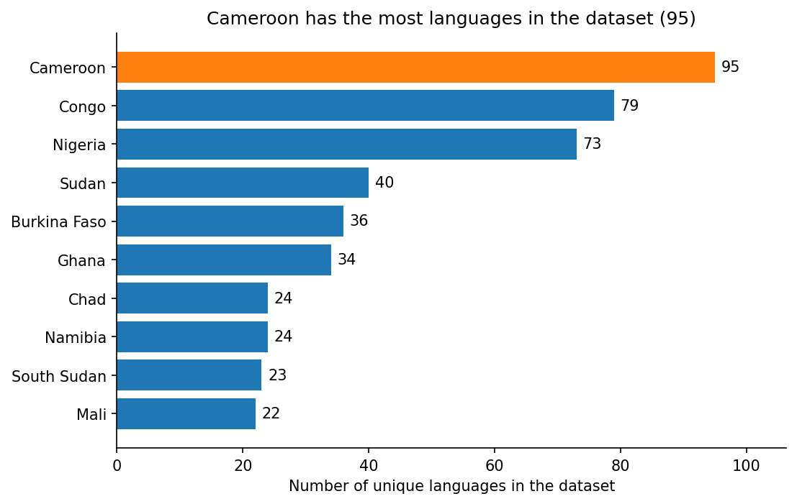

## The data

- TidyTuesday 2026-01-13: **Languages of Africa** (scraped from Wikipedia)
- One row per language–country pair: language, family, native speakers, country
- **796 rows**, **502 languages**, **51 countries**, 17 language families

::: {.notes}
Africa has 1,250–2,100+ languages; this table covers the popular ones only.
:::

## Question

> Which country in Africa has the largest number of spoken languages?

- Count **unique** languages per country (34 rows are exact duplicates)

## Result: Cameroon leads

{fig-align="center" width="80%"}

## Takeaways

- **Cameroon** has the most languages in the dataset (**95**), then "Congo" (79) and Nigeria (73)
- Highly uneven: the **median** country has only **9** listed languages
- A handful of West and Central African countries dominate the top 10

## Caveats

- **"Congo" = two countries**: the cleaning regex merges DR Congo and Republic of the Congo
- **Popular languages only**: ~500 of Africa's 1,250–2,100+ languages
- Descriptive counts, **not causes**

## Reproducibility

- Analysis notebook published as a **MyST** website
- Deployed to **GitHub Pages** by a GitHub Action on every push
- Code, data and slides: [github.com/Mirandazhu02/lab10](https://github.com/Mirandazhu02/lab10)
