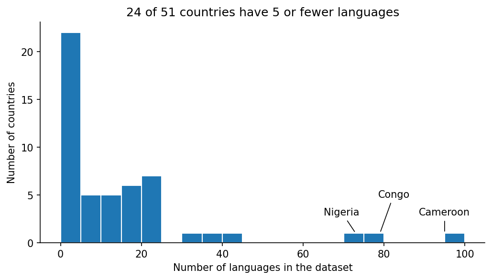
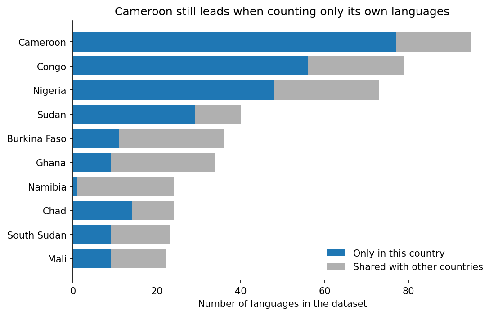
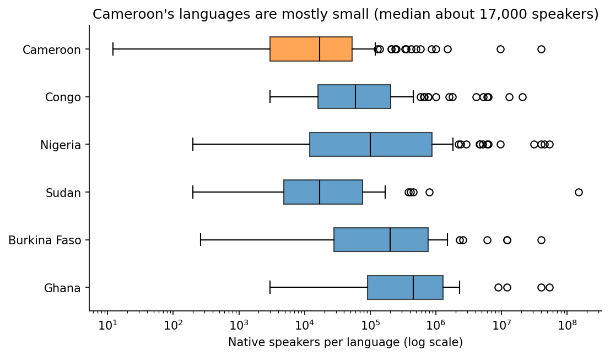

## The data

- TidyTuesday 2026-01-13: **Languages of Africa** (scraped from Wikipedia)
- One row per language–country pair: language, family, native speakers, country
- **502 languages**, **51 countries**, 16 language families
- Cleaning: drop 34 duplicate rows, merge two spellings of *Afroasiatic*

::: {.notes}
Africa has 1,250–2,100+ languages; this table covers the popular ones only.
:::

## Answer: Cameroon (95 languages)

{fig-align="center" width="78%"}

## Very uneven across countries

{fig-align="center" width="80%"}

- Median country: **9** languages · 24 of 51 have **5 or fewer**
- Cameroon, Congo and Nigeria hold **46%** of all languages

## Is the answer robust?

{fig-align="center" width="70%"}

- Counting only languages found **nowhere else**: Cameroon still first (**77**)
- Splitting the merged "Congo" row can only lower it

## Why Cameroon? Many small languages

{fig-align="center" width="75%"}

- Median **~17,000** native speakers per language (Nigeria: ~100,000)
- **92 of 95** are Niger–Congo: diversity *within* one family

## Caveats

- **"Congo" = two countries**: the cleaning regex merges DR Congo and Republic of the Congo
- **Popular languages only**: ~500 of Africa's 1,250–2,100+ languages
- Speaker counts are rough Wikipedia estimates
- Descriptive counts, **not causes**

## Reproducibility

- Analysis notebook published as a **MyST** website
- Deployed to **GitHub Pages** by a GitHub Action on every push
- Website: [mirandazhu02.github.io/lab10](https://mirandazhu02.github.io/lab10/)
- Code and data: [github.com/Mirandazhu02/lab10](https://github.com/Mirandazhu02/lab10)
